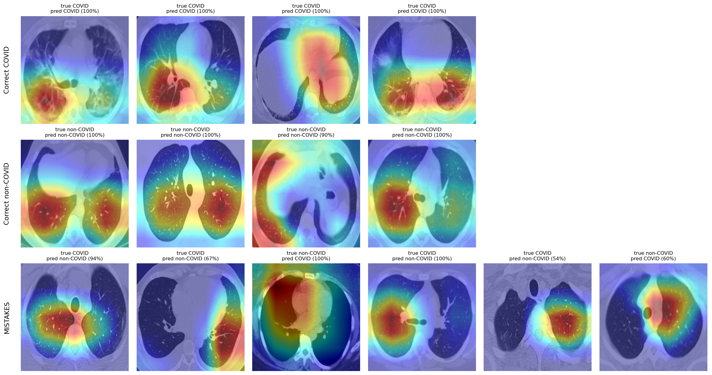
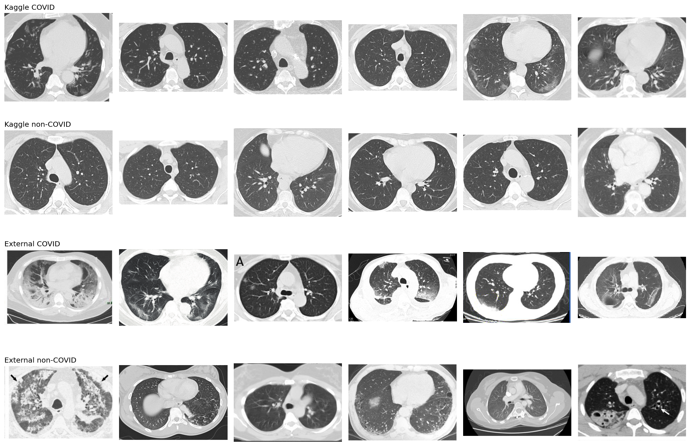

# COVID-19 Detection from Chest CT Scans (PyTorch)

A deep learning pipeline that classifies chest CT slices as COVID-19 or non-COVID, built to ask a harder question than "how high can accuracy go?": **does the model still work on scans from a different source?**

> **Educational project. Not a medical device.** This model has not been clinically validated and must not be used to make health decisions. Real diagnosis requires PCR testing and a clinician.

**Live demo:** https://covid-ct-classifier.streamlit.app

## Summary

- Built a **CNN from scratch** and fine-tuned a **pretrained ResNet18**; ResNet18 reached 98.4% accuracy (AUC 0.995) on a held-out split of the Kaggle dataset.
- Tested the same model on a **second, independent dataset (COVID-CT)** and found that it **fell to chance level (AUC 0.59)**. The 98.4% was largely an artifact of the first dataset, not evidence of real generalization.
- Diagnosed the gap (patient-level leakage, annotations burned into images, scanner and contrast differences) and ran a **mitigation experiment** with a leakage-aware split.
- Added **Grad-CAM** explainability, **threshold tuning** for screening-style sensitivity, and a **Streamlit demo** that states the model's limits.

## Results

### 1. Same-dataset performance (Kaggle held-out test split, 373 images)

| Model | Accuracy | Sensitivity | Specificity | ROC-AUC |
|---|---|---|---|---|
| CNN from scratch | 89.5% | 83.7% | 95.2% | 0.948 |
| ResNet18 (transfer learning) | 98.4% | 97.8% | 98.9% | 0.995 |

Transfer learning cut the CNN's errors by about 85%. These numbers are **inflated** (see Limitations).

### 2. Cross-dataset test (trained on Kaggle only, tested on all 746 COVID-CT images)

| Model | Accuracy | Sensitivity | Specificity | ROC-AUC |
|---|---|---|---|---|
| CNN from scratch | 47.9% | 69.9% | 28.5% | 0.456 |
| ResNet18 | 51.2% | 71.3% | 33.5% | 0.592 |

An AUC near 0.5 is chance. The model largely does not transfer to scans from a different source.

### 3. Mitigation experiment (same ResNet18, identical test images)

The external data was split **by source paper** (COVID class) into train / validation / test, so the external test images were never used for training or model selection.

| Run | Training data | Kaggle test acc / AUC | External test acc / AUC |
|---|---|---|---|
| `baseline` | Kaggle, light augmentation | 98.4% / 0.995 | 44.0% / 0.463 |
| `aug` | Kaggle, strong augmentation | 95.2% / 0.993 | 53.9% / 0.534 |
| `mixed` | Kaggle + external train split, strong augmentation | 93.6% / 0.992 | 74.6% / 0.864 |

(External test set: 193 images.)

- **Strong augmentation alone did not fix the problem** (external AUC 0.534, still near chance).
- **Training on part of the external data helped substantially** (AUC 0.463 → 0.864) with almost no change in Kaggle AUC. This is **adaptation to a second data source, not generalization to an unseen one**.

### 4. Threshold tuning (`mixed` model)

A screening-style setting favors catching COVID cases. The decision threshold was chosen on the **external validation split** (the highest threshold reaching 90% sensitivity), then applied unchanged to the test sets: **P(COVID) > 0.12 is flagged**.

| Test set | Threshold | Accuracy | Sensitivity | Specificity |
|---|---|---|---|---|
| Kaggle | 0.50 | 93.6% | 90.8% | 96.3% |
| Kaggle | 0.12 | 94.6% | 96.2% | 93.1% |
| External (n=193) | 0.50 | 74.6% | 57.8% | 89.3% |
| External (n=193) | 0.12 | 80.3% | 82.2% | 78.6% |

Lowering the threshold raised sensitivity at the cost of more false alarms. With 169 validation and 193 test images, these figures carry roughly ±6 points of uncertainty.

## Explainability (Grad-CAM)

Grad-CAM heatmaps were generated from the last ResNet block. The grid below uses the **Kaggle-only `baseline` model** (before the mitigation experiment) on held-out test images: correct COVID, correct non-COVID, and every one of its 6 mistakes.



Observations (hypotheses, not proof):

- In most correct cases the heat sits on lung tissue, often lower or peripheral regions.
- Some predictions, including three confident errors, show heat on the heart or central chest instead of the lungs, which suggests the model sometimes uses cues unrelated to lung pathology.
- Grad-CAM here is coarse (a 7×7 feature map upsampled to 224×224). It shows regions, not lesions.

## Why the external test failed



- **Uniform vs. messy sources.** Kaggle scans are clean, full-chest slices in a consistent window. COVID-CT images were cropped from published papers and include arrows, letters, text, black borders, and varied contrast windows.
- **Possible shortcuts.** In a demo example the heatmap peaked on a red circle drawn on the image. Annotations like this can act as a cue.
- **Class definition differs.** Kaggle's non-COVID class mostly looks like clean lungs; COVID-CT's non-COVID class includes visibly abnormal scans. A model that learned "abnormal lungs = COVID" would break here (external specificity was 0.335).

## Limitations

- **Patient-level leakage in the Kaggle data.** The dataset has no patient IDs and comes from only 60 COVID and 60 non-COVID patients, so near-identical slices from one patient can appear in train and test. The 98.4% is optimistic.
- **The external split is only partly leak-proof.** COVID images were grouped by source paper; non-COVID filenames carry no paper ID, so some same-source images may sit on both sides.
- **Small test sets.** The external test set has 193 images.
- **The `mixed` result is adaptation, not generalization.** A third, fully independent dataset would be needed to measure generalization.
- **The threshold was tuned on external-style validation data**, so it may not suit other scanners or populations.
- **Probabilities are uncalibrated and often near 0% or 100%.**
- **The model answers for any input.** It has no concept of "this is not a chest CT."
- **No clinical validation.** Do not use for diagnosis.

## Project structure

```
src/
  data.py          data splits, augmentation, loaders
  model.py         SimpleCNN (from scratch) and ResNet18 (transfer learning)
  train.py         training loop (python src/train.py cnn | resnet)
  evaluate.py      test-set metrics, confusion matrix, ROC
  gradcam.py       Grad-CAM for a single image
  gradcam_grid.py  Grad-CAM grid over test images, including mistakes
  cross_eval.py    evaluation on the external dataset
  domain_shift.py  dataset size/brightness stats and sample grid
  experiment.py    baseline / aug / mixed mitigation experiment
  threshold.py     threshold selection on validation data
  app.py           Streamlit demo
outputs/           plots, result JSON files, and the demo model (resnet_mixed_best.pt)
```

## Setup

Requires Python 3.9+. Tested on an Apple Silicon Mac (uses the MPS GPU if available, otherwise CPU).

```bash
python3 -m venv venv
source venv/bin/activate
pip install -r requirements-full.txt
```

`requirements.txt` is a slim list used for deploying the demo app; `requirements-full.txt` has everything needed for training and evaluation.

## Data

The datasets are not included in this repo.

1. **SARS-CoV-2 CT Scan Dataset** (Kaggle, Plamen Eduardo): 2,482 slices, 1,252 COVID and 1,230 non-COVID from 120 patients. Place images in `data/raw/COVID/` and `data/raw/non-COVID/`.
2. **COVID-CT** (Zhao et al., 2020): 349 COVID and 397 non-COVID images. Place them in `data/external/COVID/` and `data/external/non-COVID/`.

All copyrights for COVID-CT images belong to the authors and publishers of the original papers.

## Reproduce

Run everything from the project root.

```bash
python src/train.py cnn
python src/train.py resnet
python src/evaluate.py cnn
python src/evaluate.py resnet
python src/gradcam_grid.py
python src/cross_eval.py
python src/domain_shift.py
python src/experiment.py baseline
python src/experiment.py aug
python src/experiment.py mixed
python src/threshold.py
streamlit run src/app.py
```

The demo app loads `outputs/resnet_mixed_best.pt`, which is included in the repo (it can be recreated with `python src/experiment.py mixed`).

## References

- Soares, E., Angelov, P., Biaso, S., Higa Froes, M., Kanda Abe, D. "SARS-CoV-2 CT-scan dataset: A large dataset of real patients CT scans for SARS-CoV-2 identification." medRxiv, 2020.
- Zhao, J., Zhang, Y., He, X., Xie, P. "COVID-CT-Dataset: a CT scan dataset about COVID-19." arXiv:2003.13865, 2020.
- Selvaraju, R. R. et al. "Grad-CAM: Visual Explanations from Deep Networks via Gradient-based Localization." ICCV, 2017.